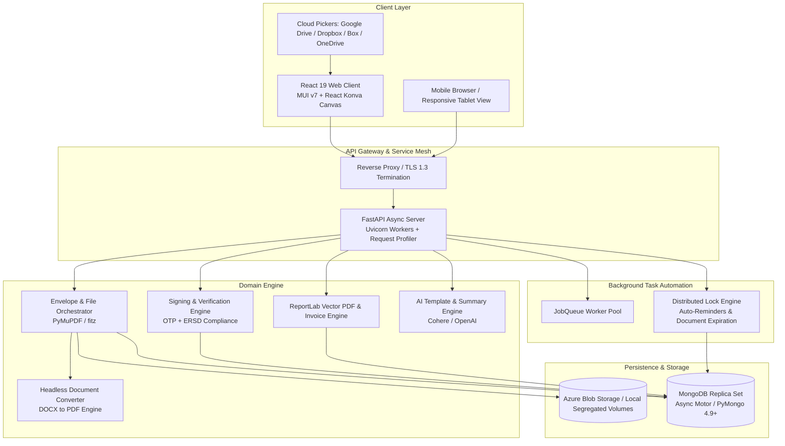
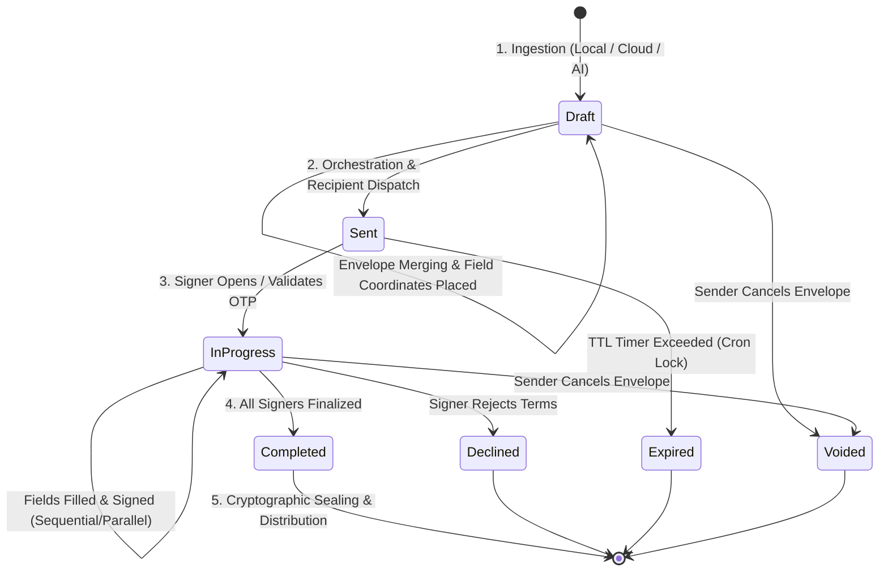
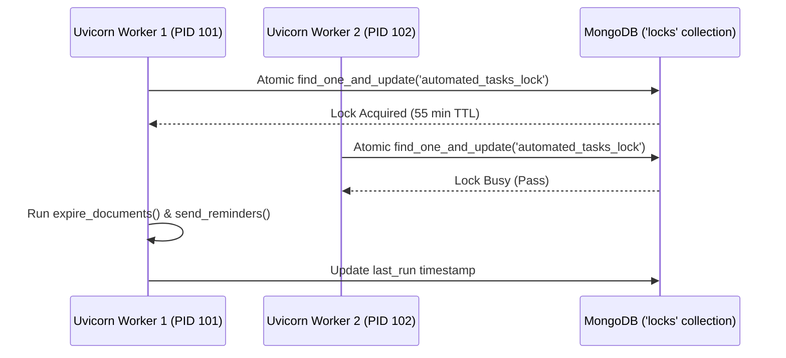

<div align="center">

**Esigniva Enterprise Documentation Suite**

[Overview](README.md) • [Security](SECURITY.md) • [Architecture](ARCHITECTURE.md) • [System Docs](SYSTEM_DOCUMENTATION.md) • [API Reference](API_DOCUMENTATION.md) • [Deployment](DEPLOYMENT.md) • [Testing](TESTING.md) • [User Guide](USER_GUIDE.md) • [Contributing](CONTRIBUTING.md) • [Changelog](CHANGELOG.md) • [License](LICENSE.md)

</div>

---

# Esigniva System Architecture

<div align="center">

[](ARCHITECTURE.md)
[](ARCHITECTURE.md)
[](ARCHITECTURE.md)
[](ARCHITECTURE.md)

</div>

---

> [!NOTE]
> Esigniva is architected as an asynchronous, non-blocking multi-tier platform. All heavy I/O operations (PDF merging, ReportLab generation, LibreOffice headless conversions, and SMTP delivery) are offloaded to asynchronous task pools to guarantee sub-100ms API response times.

---

## 1. High-Level Architectural Topology



---

## 2. The SafeFlow Document Lifecycle



### Phase 1: Ingestion & Envelope Assembly
- **Multi-File Uploads:** Users can upload multiple files of varying formats (`.pdf`, `.docx`, `.png`, `.jpg`).
- **Headless Conversion:** Non-PDF documents are routed to a headless LibreOffice container running `soffice --headless --convert-to pdf`.
- **PyMuPDF Normalization:** All files are merged into a unified envelope PDF (`fitz.open()` followed by `doc.insert_pdf()`). Page count, media box boundaries, and orientations are cataloged in `document_files`.

### Phase 2: Canvas Builder & Coordinate Translation
- **Coordinate Standard:** The React Konva visual builder utilizes a **Top-Left (0, 0)** Cartesian coordinate space.
- **DPI Normalization:** Standard PDF dimensions operate on Points (1 pt = 1/72 inch). Browser pixels are scaled proportionally:

$$\text{Scale Ratio} = \frac{\text{Canvas Rendered Width}}{\text{Native PDF Page Width}}$$

> [!TIP]
> Coordinates are persisted in MongoDB as normalized percentages $(X\%, Y\%, W\%, H\%)$. This prevents coordinate drift when opening envelopes across varying screen resolutions (e.g. mobile vs. 4K desktop).

<details>
<summary><b>View Coordinate Mapping Mathematical Proof</b></summary>

<br/>

When placing a field on the client canvas at pixel position $(x_{client}, y_{client})$ on a canvas rendered at width $W_{rendered}$ and height $H_{rendered}$:

$$\text{Normalized } X = \frac{x_{client}}{W_{rendered}}, \quad \text{Normalized } Y = \frac{y_{client}}{H_{rendered}}$$

During backend burn-in with PyMuPDF, native PDF dimensions $(W_{pdf}, H_{pdf})$ are retrieved from the page rect (`page.rect`):

$$X_{pdf} = \text{Normalized } X \times W_{pdf}, \quad Y_{pdf} = \text{Normalized } Y \times H_{pdf}$$

This guarantees exact spatial alignment down to fractional PDF point coordinates.

</details>

---

### Phase 3: Recipient Orchestration & Signing Topology
1. **Parallel Routing:** All recipients receive access tokens simultaneously. Any signer can sign at any time.
2. **Sequential Routing:** Enforces a strict order:
   $$\text{Signer } N \implies \text{Completed} \implies \text{Trigger Notification for Signer } (N+1)$$
- **Role Permissions:**
  - `signer`: Mandatory field interaction and signature capture.
  - `approver`: Reviews document, clicks "Approve" (no signature fields required).
  - `viewer`: Read-only receipt upon envelope completion.

### Phase 4: Live Signing & ERSD Acceptance
- Recipient accesses the session via high-entropy token URL.
- **ERSD Verification:** The recipient must explicitly accept the Electronic Record and Signature Disclosure before fields are unlocked.
- **Signature Pad Engine:** Captures vector stroke points via `signature_pad` or typography choices, outputting PNG data streams with transparent alpha channels.

### Phase 5: Digital Burn-in, Sealing & Distribution
- **PyMuPDF Flattening:** Backend embeds signature images and text values directly into the PDF content stream at exact coordinate offsets.
- **Cryptographic Audit Stamp:** The document receives a unique SHA-256 digest.
- **Certificate of Completion:** Generates a standalone legal audit trail document containing:
  - Envelope ID and document name.
  - Signer full name, email, IP address, and localized timestamp.
  - Event chronology (Viewed, Signed, Approved).

---

## 3. Asynchronous Worker Architecture & Distributed Locking



### 3.1 Distributed MongoDB Lock (`automated_tasks_lock`)
- Automated background tasks (document expiration scanner and email reminders) execute on an asynchronous loop in `main.py`.
- Multi-worker conflict is prevented using an atomic MongoDB lock:
  ```python
  lock = await db.locks.update_one(
      {"name": "automated_tasks_lock", "last_run": last_run},
      {"$set": {"last_run": now, "locked_by": os.getpid()}}
  )
  ```
- If a worker acquires the lock, it executes `expire_documents()` and `send_reminders()`, holding the lock for 55 minutes before allowing subsequent cycles.

### 3.2 In-Process JobQueue Worker Pool
- Non-blocking I/O operations (heavy PDF rendering, ReportLab invoice generation, and third-party SMTP calls) are queued in `job_queue.py`.
- Workers poll the queue at 2.0-second intervals to prevent thread saturation on the main FastAPI event loop.

---

## 4. Database Schema & Indexing Catalog

<details>
<summary><b>Click to Expand Complete Database Index Manifest</b></summary>

<br/>

The database indexing schema in `backend/main.py` establishes the following compound and unique indexes:

```python
# Documents Collection
await db.documents.create_index([("owner_id", 1), ("status", 1), ("created_at", -1)])
await db.documents.create_index([("owner_id", 1), ("updated_at", -1)])
await db.documents.create_index([("envelope_id", 1)], sparse=True)
await db.documents.create_index([("status", 1), ("created_at", -1)])

# Recipients Collection
await db.recipients.create_index([("document_id", 1), ("signing_order", 1)])
await db.recipients.create_index([("email", 1), ("status", 1)])
await db.recipients.create_index([("signing_token_hash", 1)], unique=True)

# Signature Fields Collection
await db.signature_fields.create_index([("document_id", 1), ("page", 1)])
await db.signature_fields.create_index([("document_id", 1), ("recipient_id", 1)])

# Audit & Invoicing Collections
await db.audit_logs.create_index([("document_id", 1), ("created_at", 1)])
await db.notifications.create_index([("user_id", 1), ("read", 1), ("created_at", -1)])
await db.document_files.create_index([("document_id", 1), ("order", 1)])
await db.locks.create_index("name", unique=True)
```

</details>

---

<div align="center">

**Esigniva Technologies** • Enterprise Electronic Signature Platform  
[Repository](https://github.com/BlueHeart-Saga/signapp) • [Security Policy](SECURITY.md) • [Terms of Use](LICENSE.md) • [Contact Support](mailto:support@esigniva.com)

<sub>Copyright © 2026 Esigniva Technologies. All rights reserved.</sub>

</div>
