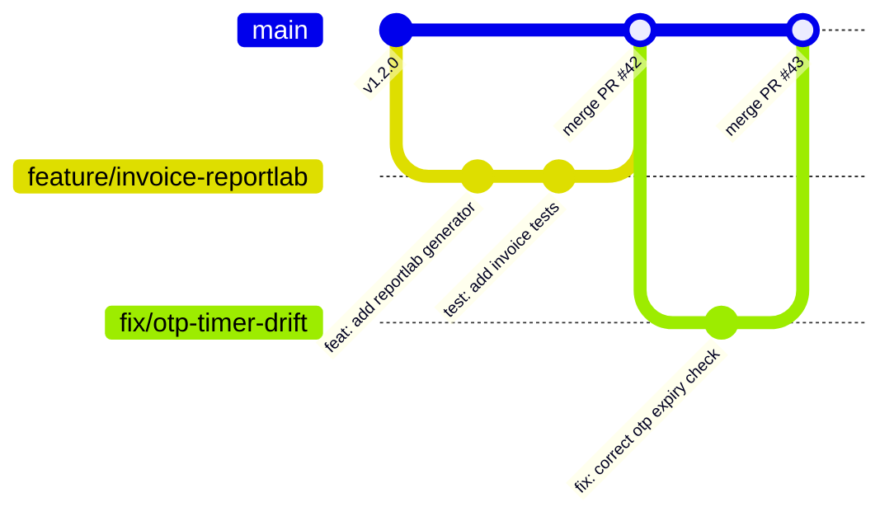

<div align="center">

**Esigniva Enterprise Documentation Suite**

[Overview](README.md) • [Security](SECURITY.md) • [Architecture](ARCHITECTURE.md) • [System Docs](SYSTEM_DOCUMENTATION.md) • [API Reference](API_DOCUMENTATION.md) • [Deployment](DEPLOYMENT.md) • [Testing](TESTING.md) • [User Guide](USER_GUIDE.md) • [Contributing](CONTRIBUTING.md) • [Changelog](CHANGELOG.md) • [License](LICENSE.md)

</div>

---

# Contributing to Esigniva

<div align="center">

[](CONTRIBUTING.md)
[](CONTRIBUTING.md)
[](CONTRIBUTING.md)
[](CONTRIBUTING.md)

</div>

---

> [!NOTE]
> All Pull Requests require passing test suites (Pytest in backend, Jest/Playwright in frontend) and adherence to Conventional Commits standards before being considered for merge approval.

---

## 1. Local Development Setup

### 1.1 Prerequisites
- Python 3.11 or later
- Node.js v18 or v20 LTS
- MongoDB v6.0 or later
- LibreOffice (Required for Word to PDF conversion)

### 1.2 Installation Steps
```bash
# Clone the repository
git clone https://github.com/BlueHeart-Saga/signapp.git
cd signapp

# 1. Setup Backend
cd backend
python -m venv .venv
# Windows:
.\.venv\Scripts\activate
# Linux/macOS:
source .venv/bin/activate

pip install -r requirements.txt
cp .env.example .env

# 2. Setup Frontend
cd ../frontend
npm install
cp .env.example .env
```

---

## 2. Git Workflow & Branching Strategy



### 2.1 Branch Naming Conventions
- `feature/<short-description>`: New capabilities or modules (e.g. `feature/reportlab-invoicing`)
- `fix/<issue-description>`: Bug fixes and security patches (e.g. `fix/signing-pad-aspect-ratio`)
- `perf/<optimization>`: Performance optimizations (e.g. `perf/pdf-render-memory`)
- `docs/<topic>`: Documentation updates (e.g. `docs/api-specs`)
- `chore/<task>`: Tooling or CI/CD updates (e.g. `chore/upgrade-react-19`)

---

## 3. Commit Message Standards (Conventional Commits)

We enforce the **Conventional Commits** specification:

```text
<type>(<optional scope>): <description>

[optional body]

[optional footer(s)]
```

<details>
<summary><b>Click to View Conventional Commit Types and Examples</b></summary>

<br/>

| Commit Type | Description | Example |
| :--- | :--- | :--- |
| `feat` | New user-facing capability | `feat(invoicing): add ReportLab vector PDF generator and tax table` |
| `fix` | Bug fix | `fix(signing-flow): resolve canvas signature blur on high-DPI displays` |
| `perf` | Performance improvement | `perf(backend): add compound index on (owner_id, status, created_at)` |
| `docs` | Documentation only change | `docs(security): update eIDAS Advanced Electronic Signature compliance specs` |
| `test` | Adding or refactoring tests | `test(signing): add concurrent parallel signing race test` |
| `refactor` | Code change that neither fixes a bug nor adds a feature | `refactor(recipients): extract token hashing into helper utility` |
| `chore` | Maintenance or dependency update | `chore(deps): update PyMuPDF to version 1.24` |

</details>

---

## 4. Coding Standards

### 4.1 Python / FastAPI (Backend)
- **Formatting:** Follow **PEP 8**. Use type hints (`from typing import Optional, List, Dict, Any`) for all public interfaces.
- **Asynchronous Execution:** Always use `async` / `await` for database, file, and network operations to preserve non-blocking event loop throughput.

### 4.2 React 19 / JavaScript (Frontend)
- **Component Design:** Use functional components with React Hooks.
- **Styling:** Use Material UI (MUI) theme tokens and styled components. Avoid raw inline style objects.
- **Code Splitting:** Lazy-load heavy pages and modal components via `React.lazy()` and `Suspense`.

---

## 5. Pull Request Checklist

Before submitting a Pull Request, confirm that:
- [ ] Your code compiles cleanly with 0 syntax or build errors.
- [ ] Unit tests have been added or updated for new features.
- [ ] All existing automated tests pass (`pytest` in backend, `npm test` in frontend).
- [ ] No sensitive credentials, secrets, or `.env` files are committed.
- [ ] Commit messages adhere to the Conventional Commits specification.

---

<div align="center">

**Esigniva Technologies** • Enterprise Electronic Signature Platform  
[Repository](https://github.com/BlueHeart-Saga/signapp) • [Security Policy](SECURITY.md) • [Terms of Use](LICENSE.md) • [Contact Support](mailto:support@esigniva.com)

<sub>Copyright © 2026 Esigniva Technologies. All rights reserved.</sub>

</div>
