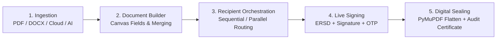

<div align="center">

**Esigniva Enterprise Documentation Suite**

[Overview](README.md) • [Security](SECURITY.md) • [Architecture](ARCHITECTURE.md) • [System Docs](SYSTEM_DOCUMENTATION.md) • [API Reference](API_DOCUMENTATION.md) • [Deployment](DEPLOYMENT.md) • [Testing](TESTING.md) • [User Guide](USER_GUIDE.md) • [Contributing](CONTRIBUTING.md) • [Changelog](CHANGELOG.md) • [License](LICENSE.md)

</div>

---

# Esigniva - Enterprise Electronic Signature Solution

<div align="center">


[](https://esigniva.com)
[](https://fastapi.tiangolo.com)
[](https://www.python.org/)
[](https://react.dev)
[](https://www.mongodb.com/)
[](https://www.docker.com/)
[](SECURITY.md)
[](LICENSE.md)

**A secure, legally binding electronic signature platform with AI document intelligence, multi-cloud storage, and automated SaaS invoicing.**

[Features](#key-capabilities) • [Architecture](#architecture--safeflow) • [Quickstart](#quickstart) • [Enterprise Documentation](#enterprise-documentation-suite) • [Security & Compliance](SECURITY.md)

</div>

---

> [!NOTE]
> Esigniva signatures are legally binding under the **United States ESIGN Act (15 U.S.C. § 7001)**, the **Uniform Electronic Transactions Act (UETA)**, and the **European Union eIDAS Regulation (EU No 910/2014)**. Every sealed envelope includes a tamper-evident Certificate of Completion with SHA-256 cryptographic digests.

---

## Enterprise Documentation Suite

The complete engineering, security, and operational documentation suite for Esigniva is organized as follows:

| Document | Focus Area | Description |
| :--- | :--- | :--- |
| [**SECURITY.md**](SECURITY.md) | Compliance & Security | Statutory frameworks, cryptographic audit trail, Email OTP, and vulnerability disclosure |
| [**ARCHITECTURE.md**](ARCHITECTURE.md) | Engineering Architecture | System topology, SafeFlow lifecycle, coordinate system, async workers, and DB schemas |
| [**SYSTEM_DOCUMENTATION.md**](SYSTEM_DOCUMENTATION.md) | Module Catalog | Enterprise module catalog, storage providers, and distributed locking |
| [**API_DOCUMENTATION.md**](API_DOCUMENTATION.md) | API Specification | REST endpoints, authentication tokens, payload schemas, and error conventions |
| [**DEPLOYMENT.md**](DEPLOYMENT.md) | Infrastructure & Cloud | Docker containerization, Azure App Services, GitHub Actions CI/CD, and environment variables |
| [**TESTING.md**](TESTING.md) | Quality Assurance | Pytest suites, Playwright E2E automation, happy paths, and critical edge cases |
| [**USER_GUIDE.md**](USER_GUIDE.md) | User & Admin Manual | End-user envelope walkthrough, guest signer experience, and admin console |
| [**CONTRIBUTING.md**](CONTRIBUTING.md) | Engineering Guidelines | Branch naming, Conventional Commits, local environment setup, and PR standards |
| [**CHANGELOG.md**](CHANGELOG.md) | Release Management | Structured release notes and version history adhering to Semantic Versioning |
| [**LICENSE.md**](LICENSE.md) | Legal Terms | Proprietary software license, terms of use, and legal validity notices |

---

## Key Capabilities

### Electronic Signatures & SafeFlow Orchestration
- **Visual Document Builder:** High-precision drag-and-drop canvas powered by React Konva for placing signatures, initials, dates, text fields, checkboxes, and dropdowns.
- **Envelope Multi-File Merging:** Combine multiple PDF, Word (`.docx`), and image files into a single unified signing envelope via `PyMuPDF` (`fitz`).
- **Flexible Workflow Topologies:**
  - **Sequential Routing:** Enforces strict signing order (Signer 1 completes before Signer 2 receives notification).
  - **Parallel Routing:** All recipients receive access tokens simultaneously and can sign concurrently.
- **Role Ecosystem:** Support for **Signers**, **Approvers** (review-only), **Witnesses**, and **Viewers**.

### Enterprise Security & Legal Compliance
- **Legally Enforceable Signatures:** Compliant with the **U.S. ESIGN Act**, **UETA**, and **EU eIDAS** regulations.
- **Mandatory ERSD Gating:** Signers must accept the Electronic Record and Signature Disclosure before document access.
- **Two-Factor Email OTP:** Optional 6-digit challenge code sent via SMTP to verify signer identity prior to viewing.
- **Cryptographic Certificate of Completion:** Standalone legal audit trail with signer IP addresses, UTC timestamps, device user-agents, and SHA-256 document digests.
- **PDF Flattening & Tamper-Evident Sealing:** Signatures and form fields are permanently bonded into the PDF stream via PyMuPDF.

### SaaS Invoicing & Billing Engine
- **Automated Invoicing:** Managed by `InvoiceService` with atomic sequential numbering (`ESI-YYYY-XXXXXX`).
- **ReportLab Vector PDF Generator:** High-resolution invoice rendering with corporate branding, tax/GST tables, and line items.
- **Stripe Integration:** Recurring subscriptions, credit top-up ledgers, and automated webhook reconciliation.

### AI Document Intelligence
- **AI Document & Template Builder:** Generate agreements from natural language prompts using Cohere and OpenAI.
- **AI Auto-Tagging:** Automatically detect signature zones and form field placements in raw business contracts.
- **Smart Summaries:** One-click executive summaries of lengthy contracts before signing.

### Cloud Integrations
- Native cloud import and export for **Google Drive**, **Dropbox**, **Microsoft OneDrive**, and **Box**.

---

## Architecture & SafeFlow



<details>
<summary><b>View Complete Technology Stack Breakdown</b></summary>

<br/>

- **Backend:** FastAPI (Python 3.11), PyMongo 4.9+ / Motor (Async MongoDB), PyMuPDF (`fitz`), ReportLab, LibreOffice Headless, Cohere / OpenAI SDKs.
- **Frontend:** React 19, Material UI (MUI) v7/v8, React Konva, Framer Motion, `@dnd-kit`, Stripe Elements, Lucide React, React-PDF.
- **DevOps & Cloud:** Docker, Docker Compose, Azure Web App for Containers, Azure App Service (Node Express), GitHub Actions CI/CD.
- **Testing:** Pytest (Backend coverage), Playwright (Frontend cross-browser E2E), Jest.

</details>

---

## Quickstart

### Prerequisites
- Python 3.11+
- Node.js 18+ or 20+
- MongoDB 6.0+ (Local instance or MongoDB Atlas)
- LibreOffice (Required for Word to PDF conversion)

### 1. Clone Repository
```bash
git clone https://github.com/BlueHeart-Saga/signapp.git
cd signapp
```

### 2. Backend Setup
```bash
cd backend
python -m venv .venv

# Windows:
.\.venv\Scripts\activate
# Linux/macOS:
source .venv/bin/activate

pip install -r requirements.txt
cp .env.example .env

# Start development server
uvicorn main:app --reload --port 8000
```
- API Root: `http://localhost:8000/`
- Interactive API Docs: `http://localhost:8000/docs`

### 3. Frontend Setup
```bash
cd ../frontend
npm install

# Start React development server
npm run dev
```
- Web Application: `http://localhost:3000`

<details>
<summary><b>View Docker Container Execution Instructions</b></summary>

<br/>

```bash
cd backend
docker build -t esigniva-backend:latest .
docker run -d -p 8000:8000 --env-file .env esigniva-backend:latest
```

</details>

---

## Production Deployment

Automated CI/CD pipelines are pre-configured in `.github/workflows/` for QA and Production Azure Web Apps. Detailed instructions are available in [DEPLOYMENT.md](DEPLOYMENT.md).

---

## Support & Inquiries

- **Billing & Licensing:** `billing@esigniva.com`
- **Security & Disclosures:** `security@esigniva.com`
- **Technical Support:** `support@esigniva.com`
- **Official Website:** [https://esigniva.com](https://esigniva.com)

---

<div align="center">

**Esigniva Technologies** • Enterprise Electronic Signature Platform  
[Repository](https://github.com/BlueHeart-Saga/signapp) • [Security Policy](SECURITY.md) • [Terms of Use](LICENSE.md) • [Contact Support](mailto:support@esigniva.com)

<sub>Copyright © 2026 Esigniva Technologies. All rights reserved.</sub>

</div>
