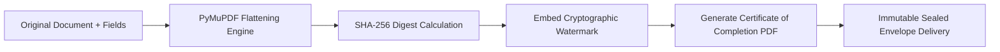

<div align="center">

**Esigniva Enterprise Documentation Suite**

[Overview](README.md) • [Security](SECURITY.md) • [Architecture](ARCHITECTURE.md) • [System Docs](SYSTEM_DOCUMENTATION.md) • [API Reference](API_DOCUMENTATION.md) • [Deployment](DEPLOYMENT.md) • [Testing](TESTING.md) • [User Guide](USER_GUIDE.md) • [Contributing](CONTRIBUTING.md) • [Changelog](CHANGELOG.md) • [License](LICENSE.md)

</div>

---

# Security & Compliance Policy

<div align="center">

[](SECURITY.md)
[](SECURITY.md)
[](SECURITY.md)
[](SECURITY.md)

</div>

---

> [!IMPORTANT]
> **Electronic Record and Signature Disclosure (ERSD):** Under the U.S. ESIGN Act and state UETA laws, signers must give informed consent to transact electronically. Esigniva blocks field access until the recipient verifies and accepts this legal disclosure.

---

## 1. Overview & Security Commitment

**Esigniva** is an enterprise-grade electronic signature and document automation platform. Because our infrastructure processes legally binding contracts, personally identifiable information (PII), and financial transactions, cryptographic integrity, statutory compliance, and data confidentiality are foundational to our platform.

---

## 2. Electronic Signature Legal Compliance

Esigniva signatures are legally binding and comply with major international electronic signature legislation:

### 2.1 United States: ESIGN Act & UETA
- **Electronic Signatures in Global and National Commerce Act (ESIGN Act, 15 U.S.C. § 7001):**
  - **Intent to Sign:** Every participant explicitly affixes a signature or initials to designated zones.
  - **Attribution & Association:** Every action is cryptographically bound to the signer's identity, IP address, user-agent, and email verification.
  - **Retention & Integrity:** Documents are stored in tamper-evident formats accessible to all signing parties.
- **Uniform Electronic Transactions Act (UETA):** Enforced across 49 U.S. states and territories.

### 2.2 European Union: eIDAS Regulation (EU No 910/2014)
- **Advanced Electronic Signature (AES) Alignment:**
  - Uniquely linked to and capable of identifying the signer.
  - Created using electronic signature creation data under the sole control of the signer.
  - Linked to the signed data such that subsequent modification is detectable.

### 2.3 India: Information Technology Act, 2000
- Section 10A provides legal validity and enforceability of electronic records and agreements.

---

## 3. Cryptographic Audit Trail & Certificate of Completion

Every completed envelope automatically generates a cryptographic **Certificate of Completion** containing an immutable audit log:



### 3.1 Audit Log Attributes Recorded
For every interaction on the platform, the backend records:
- **Unique Event ID:** UUIDv4 generated per action.
- **Timestamp:** High-precision UTC timestamp synchronized via NTP.
- **Client IP Address:** Real client IP extracted through proxy headers (`X-Forwarded-For`).
- **Geolocation:** Approximated city, region, and country derived from IP data.
- **User Agent & Device Fingerprint:** Browser engine, operating system, and hardware profile.
- **Action Type:** Document Uploaded, Viewed, Field Filled, OTP Requested, Signed, Declined, Voided, or Completed.
- **Document Hash:** SHA-256 cryptographic digest of the document at each lifecycle transition.

<details>
<summary><b>View Sample Cryptographic Audit Trail JSON Schema</b></summary>

<br/>

```json
{
  "envelope_id": "664fa29ab512c9e472a10456",
  "document_sha256": "e3b0c44298fc1c149afbf4c8996fb92427ae41e4649b934ca495991b7852b855",
  "events": [
    {
      "event_id": "d1c2b3a4-5e6f-7a8b-9c0d-1e2f3a4b5c6d",
      "action": "DOCUMENT_VIEWED",
      "actor_email": "signer@enterprise.com",
      "timestamp_utc": "2026-10-22T10:14:02.124Z",
      "ip_address": "198.51.100.45",
      "user_agent": "Mozilla/5.0 (Windows NT 10.0; Win64; x64) AppleWebKit/537.36"
    },
    {
      "event_id": "a9b8c7d6-e5f4-3a2b-1c0d-9e8f7a6b5c4d",
      "action": "SIGNATURE_AFFIXED",
      "actor_email": "signer@enterprise.com",
      "timestamp_utc": "2026-10-22T10:15:30.842Z",
      "ip_address": "198.51.100.45",
      "user_agent": "Mozilla/5.0 (Windows NT 10.0; Win64; x64) AppleWebKit/537.36"
    }
  ]
}
```

</details>

---

## 4. Signer Identity Verification & Access Control

### 4.1 Two-Factor Email OTP (One-Time Password)
- Optional and configurable per recipient by the envelope sender.
- Generates a cryptographically random numeric code (6 digits) with a 10-minute expiration window.
- The recipient cannot view or interact with the document canvas until the OTP challenge succeeds.
- Enforces rate-limiting: maximum 5 attempts before temporary token lockout.

### 4.2 Secure Single-Use Signing Tokens
- Signing URLs contain a high-entropy token (`uuid.uuid4()`).
- Tokens are stored as SHA-256 hashes in MongoDB (`signing_token_hash` unique index).
- Once the envelope reaches a terminal state (`completed`, `voided`, `declined`, or `expired`), the token is immediately invalidated.

---

## 5. Data Encryption & Storage Security

### 5.1 Data in Transit
- **TLS 1.3 Enforcement:** All HTTP traffic is enforced over HTTPS with HSTS enabled. Insecure HTTP requests are redirected automatically.
- **Strict Transport Security:** Modern cipher suites only (ECDHE-RSA-AES128-GCM-SHA256 and higher).
- **Session Security:** Session cookies enforce `SameSite=None`, `Secure=True`, and `HttpOnly=True`.

### 5.2 Data at Rest
- **Database:** MongoDB documents stored with encryption at rest using AES-256.
- **Cloud Assets:** Azure Blob Storage encrypted using Microsoft-managed or customer-managed keys (SSE with AES-256).
- **Local Fallback:** Files stored in dedicated `/uploads` directories are segregated by tenant and restricted via file system permissions.

### 5.3 Document Immutability & Flattening
- On completion, documents undergo **PDF Flattening** via `PyMuPDF` (`fitz`).
- Interactive form fields and signature layers are converted into static, rasterized vector artwork permanently bonded to the PDF stream.
- Post-completion modification invalidates the SHA-256 checksum recorded in the audit trail.

> [!CAUTION]
> Any external attempt to alter or manipulate a finalized PDF breaks its SHA-256 signature hash, immediately rendering the Certificate of Completion invalid in legal proceedings.

---

## 6. Vulnerability Disclosure & Reporting

We welcome responsible security research and vulnerability reports.

### 6.1 Reporting Procedure
If you discover a security vulnerability in Esigniva, please disclose it responsibly:
- **Email:** `security@esigniva.com`
- **Subject:** `[SECURITY DISCLOSURE] Brief summary of vulnerability`
- **Expected Response:** Initial acknowledgment within 24 business hours; triage report within 72 business hours.

### 6.2 Disclosure Guidelines
Please adhere to the following principles:
- Provide detailed reproduction steps, including proof-of-concept scripts or screenshots.
- Do not exploit the vulnerability to view, modify, or exfiltrate customer data.
- Do not execute denial of service (DoS/DDoS) attacks against production infrastructure.
- Allow our security engineering team **90 days** to remediate the vulnerability before public disclosure.

---

<div align="center">

**Esigniva Technologies** • Enterprise Electronic Signature Platform  
[Repository](https://github.com/BlueHeart-Saga/signapp) • [Security Policy](SECURITY.md) • [Terms of Use](LICENSE.md) • [Contact Support](mailto:support@esigniva.com)

<sub>Copyright © 2026 Esigniva Technologies. All rights reserved.</sub>

</div>
