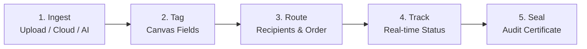

**Esigniva Enterprise Documentation Suite**

[Overview](README.md) • [Security](SECURITY.md) • [Architecture](ARCHITECTURE.md) • [System Docs](SYSTEM_DOCUMENTATION.md) • [API Reference](API_DOCUMENTATION.md) • [Deployment](DEPLOYMENT.md) • [Testing](TESTING.md) • [User Guide](USER_GUIDE.md) • [Contributing](CONTRIBUTING.md) • [Changelog](CHANGELOG.md) • [License](LICENSE.md)

---

# Esigniva Platform User & Administrator Guide

---

> [!NOTE]
> Esigniva allows guest signers to review and sign envelopes without registering an account. All signatures are legally binding under the **US ESIGN Act**, **UETA**, and **EU eIDAS**.

---

## 1. The 5-Step Envelope Lifecycle

### Step 1: Upload & Prepare Documents
- **Local Uploads:** Upload any `.pdf`, `.docx`, or `.png/.jpg` file. Word documents are converted automatically to PDFs.
- **Multi-File Envelope Merging:** Upload multiple documents simultaneously. The system combines them into a single continuous envelope.
- **Cloud Connect:** Import directly from **Google Drive, Dropbox, Box, or Microsoft OneDrive**.
- **AI Document Generator:** Enter a natural language prompt to generate an agreement template instantly.

### Step 2: Canvas Builder & Field Placement
1. Select a recipient from the recipient dropdown.
2. Drag desired fields onto the canvas:
   - **Signature & Initials:** Legally binding drawn, typed, or uploaded signatures.
   - **Text Fields:** Names, addresses, job titles, or custom notes.
   - **Date Fields:** Formatted dates (defaults to signature execution date).
   - **Checkboxes & Dropdowns:** Choice selections and confirmation gates.
3. Click **AI Assist (Auto-Tag)** to automatically detect signature zones and place fields.

### Step 3: Recipient Orchestration & Signing Order
- **Assign Roles:**
  - `Signer`: Must fill required fields and sign.
  - `Approver`: Reviews the document and clicks "Approve" (no signature fields required).
  - `Viewer`: Receives a final sealed copy for archival purposes.
- **Configure Signing Topology:**
  - **Parallel:** All signers receive invitations simultaneously and can sign in any order.
  - **Sequential:** Strict order enforcement (Signer 1 completes before Signer 2 is notified).
- **Two-Factor Email OTP:** Enable OTP per recipient. The signer must enter a 6-digit code delivered to their inbox before viewing the document.

### Step 4: Tracking & Envelope Management
Monitor active envelopes from your **My Documents** dashboard:
- **Statuses:** `Draft`, `Sent`, `In Progress`, `Completed`, `Declined`, `Voided`, and `Expired`.
- **Actions:**
  - **Send Reminder:** Sends an automated reminder notification email to pending signers.
  - **Void Envelope:** Cancels an active signing session if changes are needed.
  - **Audit History:** Inspect real-time timeline events (opened, viewed, signed).

### Step 5: Finalization & Audit Certificate
Once the final recipient signs:
- All parties receive an automated completion email.
- The document is permanently flattened and digitally sealed with a SHA-256 cryptographic checksum.
- Includes a formal **Certificate of Completion** recording signer identities, IP addresses, timestamps, and legal disclosures.

---

## 2. Recipient Signing Experience (Guest Signers)

Recipients do not need an Esigniva account to sign documents:

1. **Accessing the Envelope:** The recipient clicks the secure link in their email invitation.
2. **Security Verification (If enabled):** The signer enters the 6-digit Email OTP sent to their address.
3. **Legal Disclosure (ERSD):** The signer reviews and accepts the Electronic Record and Signature Disclosure.
4. **Interactive Navigation:** The interface guides the signer through every required field.
5. **Adopting a Signature:**
   - **Draw:** Draw with a mouse, finger, or stylus on touchscreen devices.
   - **Type:** Choose from high-fidelity typography styles.
   - **Upload:** Upload an existing signature image file.
6. **Submit:** Click "Finish". A signed copy and audit certificate are immediately made available for download.

---

## 3. Subscriptions, Credits & Invoicing

- Manage account plans from **Settings → Subscription**.
- Each plan includes a monthly envelope quota. If your team exhausts its quota, purchase additional **Signing Credits** with instant activation.
- Download vector PDF invoices generated via ReportLab containing your corporate billing address and tax/GST registration numbers from your billing dashboard.

---

## 4. Enterprise Administration Console

<b>Click to View Enterprise Administration Console Capabilities</b>

 

Users with the `admin` role have access to the **Admin Control Center**:
- **User Management:** View all registered users, verify account statuses, and manage role assignments.
- **Dynamic Branding:** Update the organization logo, primary brand color, and portal favicon across all signers' interfaces.
- **Global Marketing Banners:** Publish system-wide announcements or maintenance notices.
- **Complaint & Feedback Portal:** Review, triage, and resolve complaints submitted by signers.
- **Envelope Inspection:** Audit organization-wide envelope volumes and compliance logs.

---

**Esigniva Technologies** • Enterprise Electronic Signature Platform  
[Repository](https://github.com/BlueHeart-Saga/signapp) • [Security Policy](SECURITY.md) • [Terms of Use](LICENSE.md) • [Contact Support](mailto:support@esigniva.com)

Copyright © 2026 Esigniva Technologies. All rights reserved.

